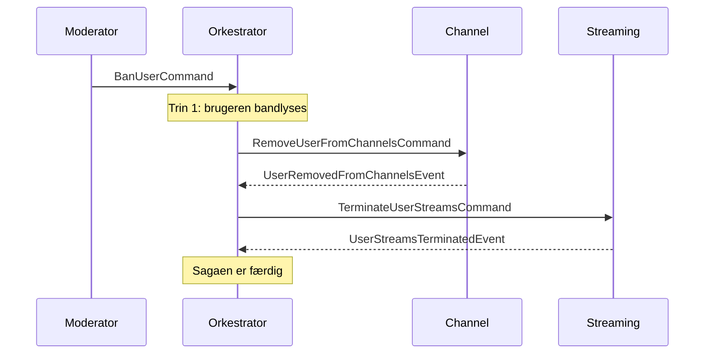
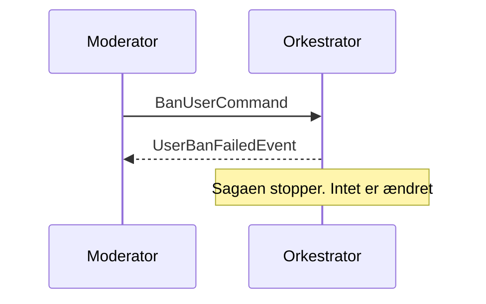
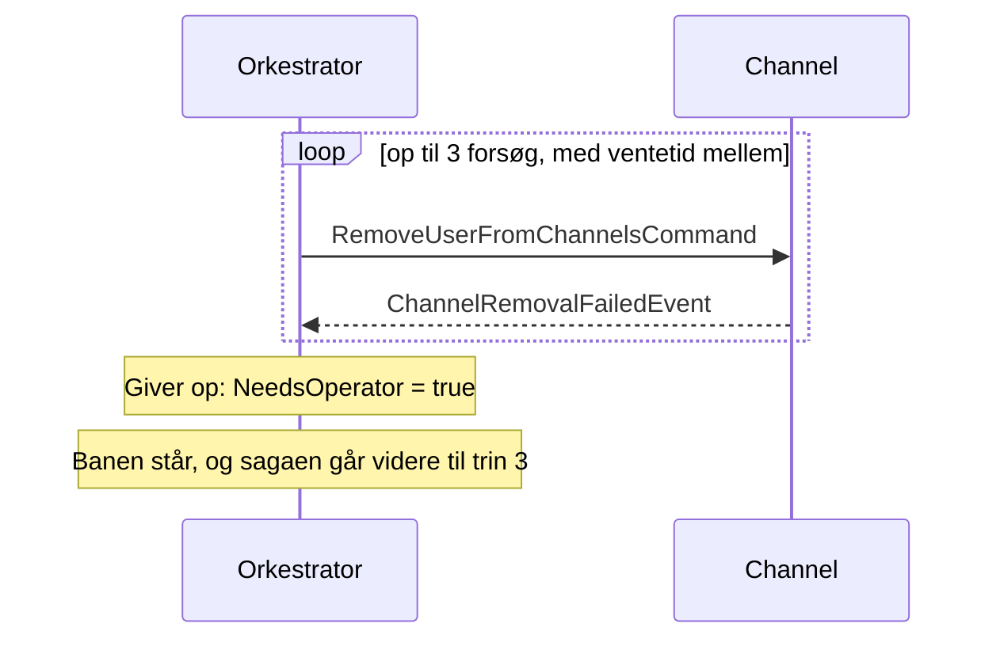
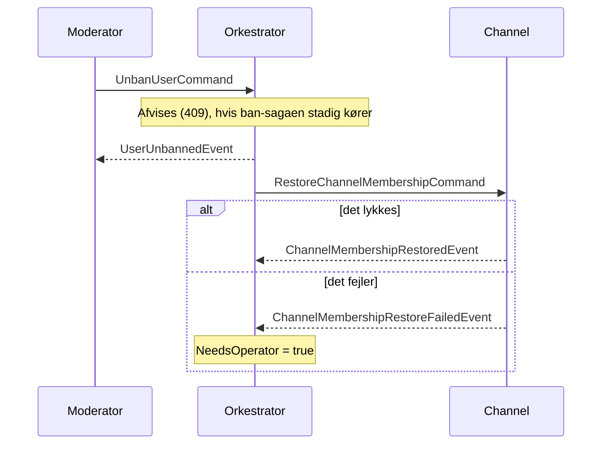

# Saga: en bruger bliver bannet

Task 02, Implement the Saga pattern. Sagaen bruger vores egen `IMessageClient`, uden saga-framework.

## 1. Scenarie

En moderator bander en bruger. Tre services er med:

| Service | Status | Opgave |
|---|---|---|
| User Service | Rigtig | Markerer brugeren som bandlyst og styrer sagaen |
| Channel | Stub (`SagaStubs.Worker`) | Fjerner brugeren fra alle kanaler |
| Streaming | Stub (`SagaStubs.Worker`) | Afslutter brugerens opkald |

Det er en saga, fordi de tre services er separate processer, som kun taler sammen med beskeder over RabbitMQ. Der er ingen fælles transaktion. Systembeskeder i kanalerne og sessions er uden for scope (se afsnit 8).

## 2. Diagrammer

"Orkestrator" er klassen `BanSagaOrchestrator` i User Service.

**Happy path**



**Fejl i trin 1** (brugeren findes ikke, eller er allerede bandlyst)



**Fejl i trin 2** (trin 3 er det samme med Streaming)



**Unban**



## 3. Trin og beskeder

| Trin | Startes af | Succes | Fejl | Kompensation | Kan reverseres? |
|---|---|---|---|---|---|
| 1. Bandlys (User Service) | `BanUserCommand` | `UserBannedEvent` | `UserBanFailedEvent` | Unban | Ja, men kun efter moderatorens beslutning |
| 2. Fjern fra kanaler (Channel) | `RemoveUserFromChannelsCommand` | `UserRemovedFromChannelsEvent` | `ChannelRemovalFailedEvent` | `RestoreChannelMembershipCommand` efter unban | Delvist. Medlemskab kan gendannes, men systembeskeden kan ikke slettes |
| 3. Afslut opkald (Streaming) | `TerminateUserStreamsCommand` | `UserStreamsTerminatedEvent` | `StreamTerminationFailedEvent` | Ingen | Nej. Opkaldet er væk |
| Unban (User Service) | `UnbanUserCommand` | `UserUnbannedEvent` | Ingen | Ny ban | Ja |
| Gendan medlemskab (Channel) | `RestoreChannelMembershipCommand` | `ChannelMembershipRestoredEvent` | `ChannelMembershipRestoreFailedEvent` | Ingen | Ja |

Alle beskeder ligger i `UserService.Messages.Bans` og har `SagaId` og `UserId`. Fejl-events har også `Reason`. Kommandoerne til Channel og Streaming har også `Attempt` (forsøg nr.), som fejl-eventet sender tilbage. `BanUserCommand` og `UnbanUserCommand` har `ModeratorId`.

## 4. Saga-state

`BanSagaState` har et flag for hvert trin: `UserBanned`, `ChannelsRemoved`, `StreamsTerminated`, og `ChannelsGaveUp` og `StreamsGaveUp` hvis et trin gav op. Hertil kommer `ChannelAttempts`, `StreamAttempts`, `MembershipRestored`, `MembershipRestoreFailed`, `IsCompleted`, `IsFailed`, `NeedsOperator`, `StartedAt` og `CompletedAt`. Den ligger bag `ISagaStateRepository` med `GetById`, `GetLatestByUserId` og `Save`.

Beskeder kan komme flere gange (at-least-once). Derfor gælder:

- En besked for et trin, der allerede er registreret i state, ignoreres.
- Et fejl-event med et forkert `Attempt` ignoreres, så en dublet ikke bruger et forsøg.
- `Ban` og `Unban` på brugeren kan køres flere gange uden ekstra effekt.

## 5. Fejl og "hard question"

Banen rulles ikke tilbage, hvis trin 2 eller 3 fejler, fordi den er en sikkerhedsbeslutning. Trin 2 og 3 prøves igen op til 3 gange (1 og 2 sekunders ventetid). Hvis de stadig fejler, sættes `NeedsOperator`, og en operatør tager over.

**Hvis banen lykkes, men opkaldet ikke kan afsluttes:** Brugeren er bandlyst. Sagaen afsluttes med `NeedsOperator`, ikke som fejlet, for banen lykkedes. Opkaldet kan køre, til en operatør afslutter det. Tilstanden kan ses med `GET api/user-profiles/sagas/{sagaId}`.

**Hvis et svar aldrig kommer:** Sagaen hænger på trinnet, fordi udeblevne svar ikke tælles som fejl. Man kunne lave en watchdog, der behandler et trin uden svar efter fx 30 sekunder som en fejl. Den er kun beskrevet og ikke lavet. Det samme gælder en liste over sagaer, der kræver en operatør.

## 6. Valg: orkestrering

**(a) Hvorfor orkestrering.** Rækkefølgen betyder noget: først bandlyses brugeren, så fjernes brugeren fra kanaler, så afsluttes opkald. Retry-reglerne og beslutningen "operatør skal handle" er samlet ét sted, så man kan se, om sagaen er færdig. De andre services svarer kun på en kommando.

Kompensation sker bevidst kun ved unban, fordi banen er en sikkerhedsbeslutning. Det adskiller sig fra Moodle-eksemplets baglæns kompensation. Her prøver vi igen frem for at rulle tilbage.

**(b) Hvad der var sværere med koreografi.** Rækkefølgen og retry-reglerne ville ligge spredt i tre services, som forskellige hold ejer. Ingen enkelt service ved, om hele sagaen er færdig. Og et nyt trin kræver, at man ændrer en anden services kode. Prisen ved orkestrering er, at User Service kender de andre services kommandoer.

**(c) Hvor state ligger.** I User Service, fordi orkestratoren kører der og skal vide, hvilke trin der allerede er gjort. Vi har ingen database, så den er gemt i hukommelsen (`InMemorySagaStateRepository`).

**Ugens fokuspunkter**

- **Konsistens:** Der er ingen fælles transaktion. Systemet bliver konsistent til sidst, og undervejs er brugeren kun delvist bandlyst.
- **Kobling:** Services deler kun kontraktprojektet `UserService.Messages`. Efter vores forståelse af EasyNetQ navngives exchange og kø efter beskedens typenavn og assembly. Det er tjekket i RabbitMQ: exchange hedder `UserService.Messages.Bans.BanUserCommand, UserService.Messages`. Flyttes kontrakterne, mister modtagerne beskederne.
- **Kan det reverseres?** Se kolonnen i afsnit 3.
- **Hvordan fejler det?** Se afsnit 2 og 5.

## 7. Kørsel og demo

| Endpoint (rolle `internal-service`) | Svar |
|---|---|
| `POST /api/user-profiles/{id}/ban` med `{ "reason": "..." }` | 202 med `sagaId` |
| `POST /api/user-profiles/{id}/unban` | 202, eller 409 mens ban-sagaen kører |
| `GET /api/user-profiles/sagas/{sagaId}` | Saga-state, eller 404 |

Stubbene fejler de første N forsøg pr. saga. Det sættes i `docker-compose.yaml` med `CHANNEL_FAIL_FIRST_ATTEMPTS` og `STREAMING_FAIL_FIRST_ATTEMPTS` (0 fejler aldrig, 99 fejler altid):

```bash
CHANNEL_FAIL_FIRST_ATTEMPTS=2 STREAMING_FAIL_FIRST_ATTEMPTS=0 docker compose up -d --force-recreate channel-stub streaming-stub
```

| Channel fejler | Streaming fejler | Resultat |
|---|---|---|
| 0 | 0 | Alt lykkes, `needsOperator` er false |
| 2 | 0 | Kanaler fjernes ved tredje forsøg (`channelAttempts` 3), `needsOperator` er false |
| 0 | 99 | Streaming giver op (`streamsGaveUp`), men `userBanned` er true og `needsOperator` er true |

## 8. Kendte begrænsninger

- State ligger i hukommelsen. Den forsvinder ved genstart og virker kun med én instans.
- Der er ingen outbox. Går servicen ned mellem at gemme state og sende en besked, kan de to være uens (samme hul som FP-02 i `FAILURE_POINTS.md`).
- Ventetiden før et nyt forsøg er et `Task.Delay` i handleren.
- Der er ingen timeout, hvis et svar udebliver (se afsnit 5).
- JWT'er har ingen state. Et token, der er udstedt før banen, virker til det udløber, så sessions kan ikke afbrydes herfra. Andre services skal selv tjekke, om brugeren er bandlyst.
- `IsBanned` tjekkes ikke af nogen endpoint endnu.
- Der postes ingen systembesked i kanalerne. Det er Channel-servicens opgave.
- Gendannelse af medlemskab prøves ikke igen. Fejler den, sættes `NeedsOperator`.
